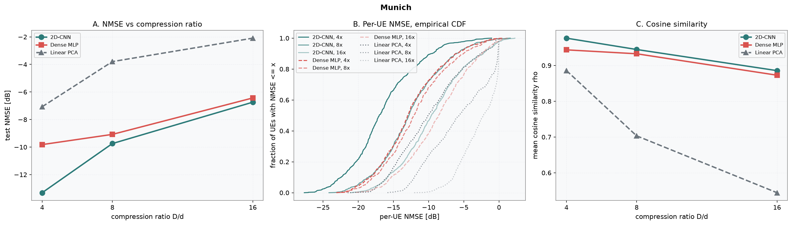
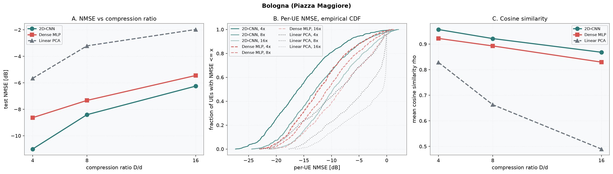
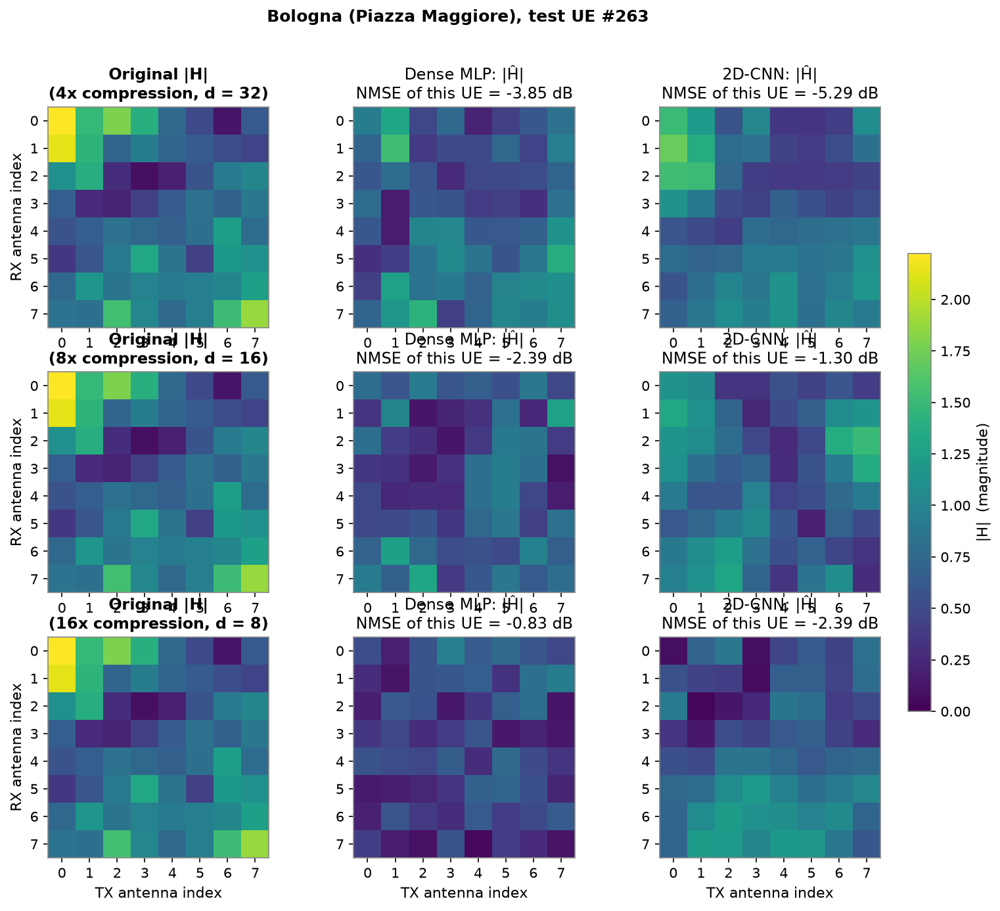

# MIMO CSI Feedback Compression

Deep-learning project exploring how efficiently a user equipment (UE) can compress a MIMO channel state information (CSI) matrix before sending it to a base station. The project compares dense and convolutional autoencoders on synthetic, ray-traced channels generated with [NVIDIA Sionna](https://nvlabs.github.io/sionna/).

<p align="center">
  
</p>
<p align="center"><em>Munich test results. Lower (more negative) NMSE indicates more accurate reconstruction.</em></p>

<p align="center">
  
</p>
<p align="center"><em>Bologna test results.</em></p>

## Project at a glance

Each sample is an 8 × 8 complex channel matrix, represented by 128 real values. The encoder maps it to a low-dimensional latent vector and the decoder reconstructs the channel. The experiments use 5,000 channel realizations for each of two simulated urban scenes: Munich and Bologna.

| Component | Description |
| --- | --- |
| Models | Dense MLP and residual 2D-CNN autoencoders, compared with linear PCA |
| Latent dimensions | 32, 16, and 8 real values |
| Dimension compression | 4×, 8×, and 16× (128 / latent dimension) |
| Evaluation | NMSE, median and percentile error, cosine similarity, and reconstruction visualizations |
| Data | Synthetic CSI from Sionna ray-traced scenes; not measured over-the-air data |

## Key results

The 2D-CNN achieves the lowest aggregate test NMSE at each tested compression ratio in both archived city evaluations.

| Scene | Model | 4× | 8× | 16× |
| --- | --- | ---: | ---: | ---: |
| Munich | 2D-CNN | **−13.85 dB** | **−9.25 dB** | **−7.11 dB** |
| Munich | Dense MLP | −9.87 dB | −9.03 dB | −6.71 dB |
| Munich | Linear PCA | −7.07 dB | −3.79 dB | −2.09 dB |
| Bologna | 2D-CNN | **−10.08 dB** | **−8.33 dB** | **−6.45 dB** |
| Bologna | Dense MLP | −8.87 dB | −7.37 dB | −5.36 dB |
| Bologna | Linear PCA | −5.67 dB | −3.21 dB | −1.98 dB |

These are archived simulation results, not a guarantee of performance on measured channels or a deployed feedback link. See [results, methodology, and limitations](docs/RESULTS_AND_LIMITATIONS.md) for additional metrics and interpretation.

## Explore the project

- [Open the interactive CSI compression introduction](Intro%20to%20the%20Problem%20Simulation.html).
- [Read the project notebook](Project_22_MIMO_CSI_Compression.ipynb) for the workflow, models, evaluation, and figures.
- [Read the project brief](docs/PROJECT_BRIEF.md) for the scope and deliverables.
- [Browse the archived figures and metric tables](results/).

### Example CSI reconstruction

<p align="center">
  
</p>

## Quick start

Requirements: Python 3.11 or newer and [uv](https://docs.astral.sh/uv/).

```bash
uv sync
uv run jupyter lab Project_22_MIMO_CSI_Compression.ipynb
```

The notebook uses the checked-in CSI datasets and archived results by default to avoid rerunning expensive ray tracing and model training. Its configuration cells contain switches for regenerating data and running the experiments; full Sionna ray tracing may require additional platform-specific setup and can take significantly longer. The project brief and notebook explain the workflow.

## Repository layout

```text
.
├── data/                                  # Cached 5,000-sample CSI datasets
├── docs/                                  # Project brief and results discussion
├── results/                               # Archived figures and evaluation CSVs
├── scenes/                                # Scene descriptions and geometry
├── .gitignore
├── LICENSE
├── Intro to the Problem Simulation.html   # Interactive introduction
├── Project_22_MIMO_CSI_Compression.ipynb  # Main executable walkthrough
├── README.md
├── pyproject.toml                         # Python dependencies
└── uv.lock                                # Locked dependency versions
```

## Scope and limitations

- CSI is simulated at 3.5 GHz; results do not validate measured channels, wideband OFDM, mobility, or channel-estimation errors.
- The latent vector is not quantized and no feedback-channel errors or protocol overhead are modeled. The stated ratios compare real-valued dimensions, not practical bit rates.
- The Bologna scene is reconstructed from OpenStreetMap data and estimated building attributes. The two city simulations differ in geometry and setup, so their performance gap cannot be attributed to city morphology alone.
- The random train/validation/test split does not establish generalization to a fully unseen geographic region.

For further details, see [the full results and limitations](docs/RESULTS_AND_LIMITATIONS.md).