# MIMO CSI Compression: Results and Limitations

## Objective

This project evaluates compression of simulated 8 × 8 complex MIMO channel matrices at 3.5 GHz. Each matrix contains 64 complex coefficients, or 128 real values. The encoder maps the channel to a latent vector of dimension `d ∈ {32, 16, 8}`, corresponding to dimension compression ratios of 4×, 8×, and 16×, and the decoder reconstructs the channel.

The experiments compare a residual 2D convolutional autoencoder, a dense MLP autoencoder, and a linear PCA baseline on the Munich and Bologna Sionna ray-tracing datasets.

## Method and design choices

- **Data:** 5,000 UE channel realizations per scene, split into 70% training, 15% validation, and 15% test (3,500 / 750 / 750).
- **Representation:** real and imaginary channel components are represented as a `2 × 8 × 8` tensor. A unitary 2D DFT is also used for angular-domain analysis.
- **Normalization:** each channel is normalized to a Frobenius norm of 8 to reduce domination by high-power channels during training. Reported KPIs are computed on the normalized channels.
- **Architectures:** the CNN uses antenna-grid neighborhoods without downsampling the small 8 × 8 input. Linear output activations allow unbounded channel components.
- **Baseline:** PCA provides a linear reference. Parameter counts are reported for the learned models to contextualize their results.

## Evaluation metrics

- **Aggregate NMSE (dB):** `10 log10(Σᵢ ||Hᵢ − Ĥᵢ||²F / Σᵢ ||Hᵢ||²F)`. Lower values indicate better overall reconstruction.
- **Median per-user NMSE (dB):** the median of individual channel NMSE values, describing a typical UE alongside the aggregate metric.
- **Complex cosine similarity:** alignment between `H` and `Ĥ`, independent of their overall scale.
- **Compression ratio:** `128 / d`. This is a real-valued dimension ratio, not a practical bit rate; the latent vector is not quantized.

## Archived results

The values below are taken from the checked-in KPI tables in `../results/`. The CNN has the lowest aggregate NMSE at every tested ratio in both archived city evaluations.

### Munich

| Model | Ratio | `d` | Aggregate NMSE (dB) | Median NMSE (dB) | Cosine similarity | Parameters |
| --- | ---: | ---: | ---: | ---: | ---: | ---: |
| 2D-CNN | 4× | 32 | −13.85 | −17.32 | 0.9792 | 141,810 |
| 2D-CNN | 8× | 16 | −9.25 | −12.34 | 0.9383 | 109,026 |
| 2D-CNN | 16× | 8 | −7.11 | −9.80 | 0.8955 | 92,634 |
| MLP | 4× | 32 | −9.87 | −12.76 | 0.9448 | 141,728 |
| MLP | 8× | 16 | −9.03 | −12.10 | 0.9313 | 137,616 |
| MLP | 16× | 8 | −6.71 | −9.21 | 0.8791 | 135,560 |
| PCA | 4× | 32 | −7.07 | −10.06 | 0.8858 | — |
| PCA | 8× | 16 | −3.79 | −5.67 | 0.7033 | — |
| PCA | 16× | 8 | −2.09 | −2.24 | 0.5443 | — |

### Bologna

| Model | Ratio | `d` | Aggregate NMSE (dB) | Median NMSE (dB) | Cosine similarity | Parameters |
| --- | ---: | ---: | ---: | ---: | ---: | ---: |
| 2D-CNN | 4× | 32 | −10.08 | −14.89 | 0.9463 | 141,810 |
| 2D-CNN | 8× | 16 | −8.33 | −12.85 | 0.9201 | 109,026 |
| 2D-CNN | 16× | 8 | −6.45 | −9.80 | 0.8756 | 92,634 |
| MLP | 4× | 32 | −8.87 | −12.43 | 0.9270 | 141,728 |
| MLP | 8× | 16 | −7.37 | −10.50 | 0.8939 | 137,616 |
| MLP | 16× | 8 | −5.36 | −7.95 | 0.8279 | 135,560 |
| PCA | 4× | 32 | −5.67 | −8.66 | 0.8286 | — |
| PCA | 8× | 16 | −3.21 | −3.88 | 0.6631 | — |
| PCA | 16× | 8 | −1.98 | −0.74 | 0.4898 | — |

At 4× compression, the CNN improves aggregate NMSE over PCA by 6.78 dB in Munich and 4.41 dB in Bologna. At 16×, the improvements are 5.01 dB and 4.47 dB, respectively. More aggressive compression degrades reconstruction quality and alignment in both scenes. Aggregate and median NMSE are complementary: the median describes a typical UE, while the aggregate weighs high-energy errors more strongly.

The archived propagation analysis reports a median ray count of 21 for Munich and 36 for Bologna. This suggests richer multipath in the modeled Bologna area, but does not establish that urban geometry alone causes the performance difference: transmitter placement, scene extent, materials, and samples also differ.

## Figures

### Scenes and radio maps

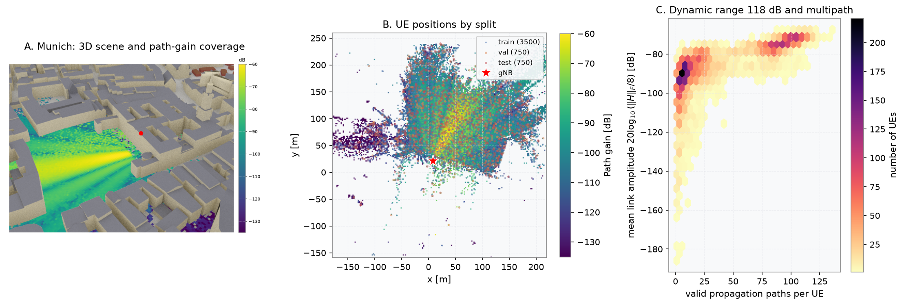

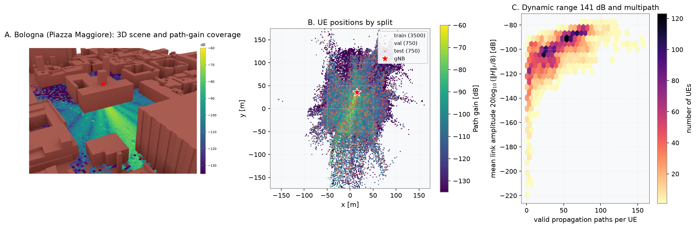

### Channel inspection and training

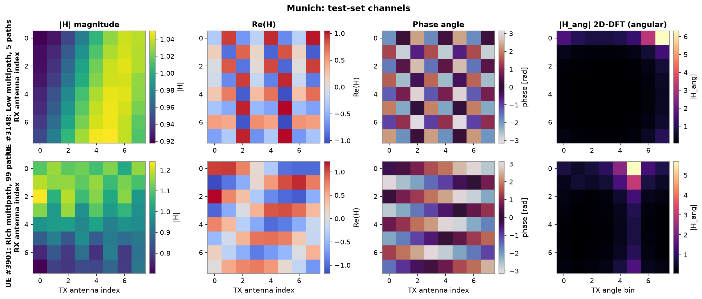

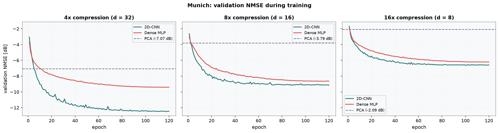

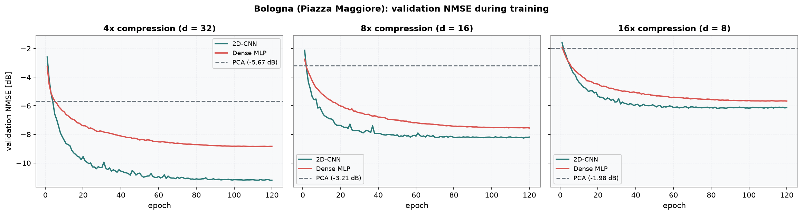

### Reconstruction and comparison

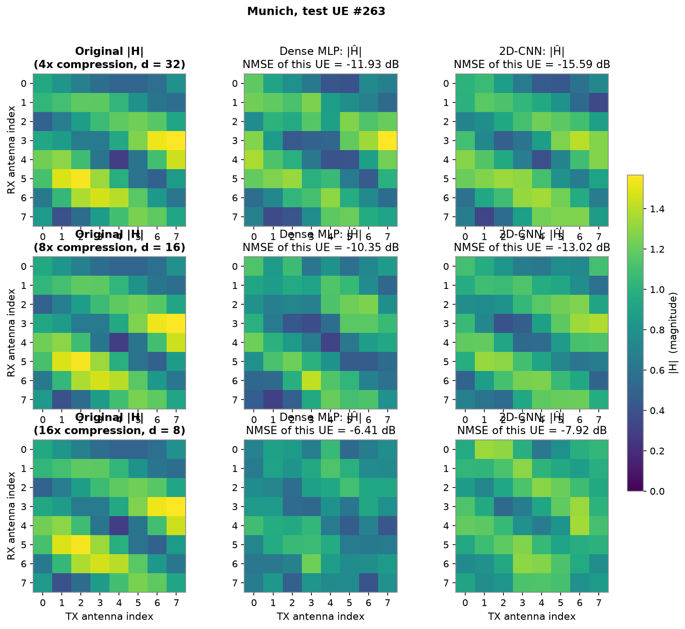

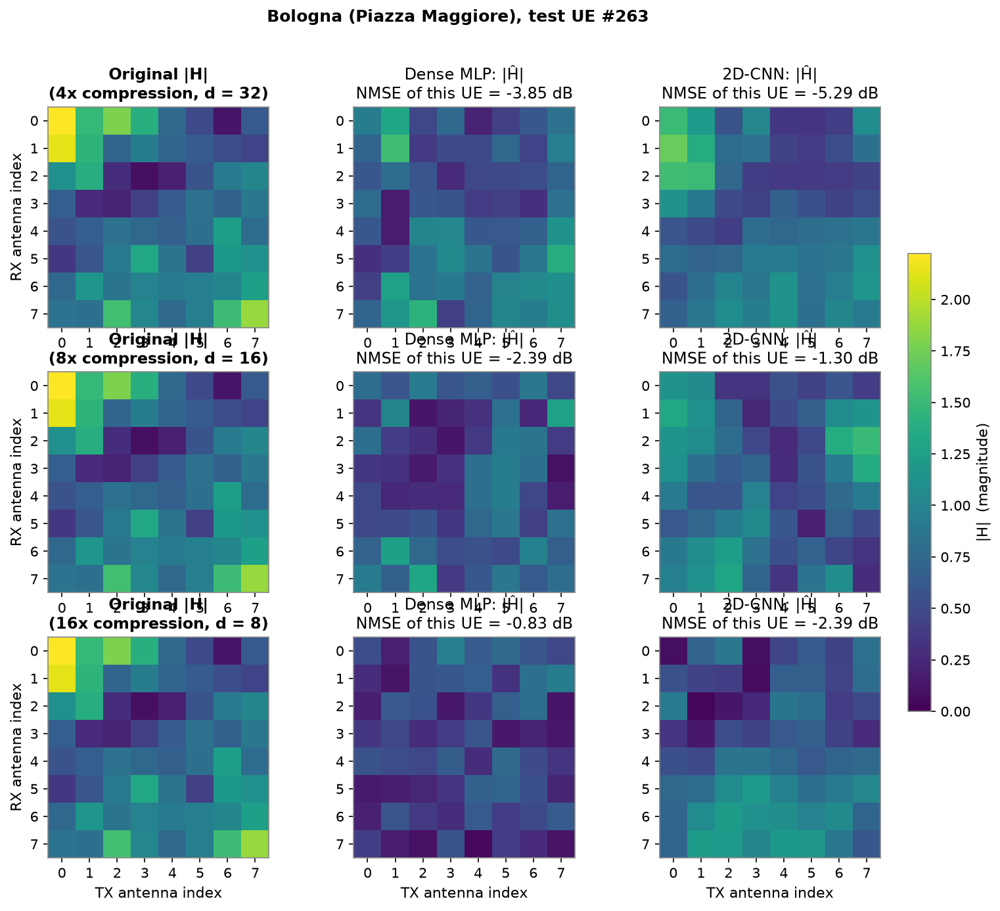

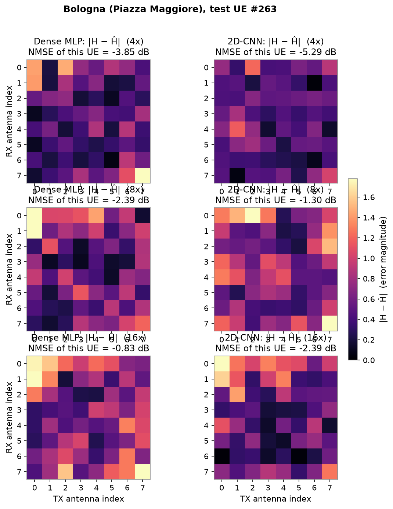

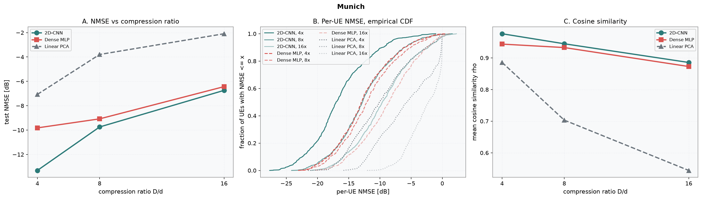

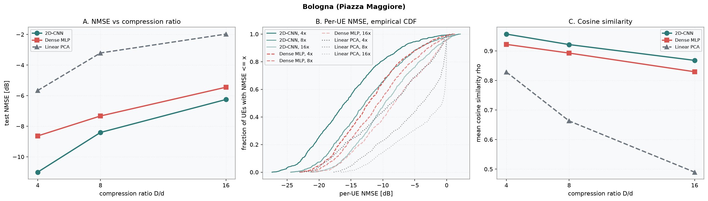

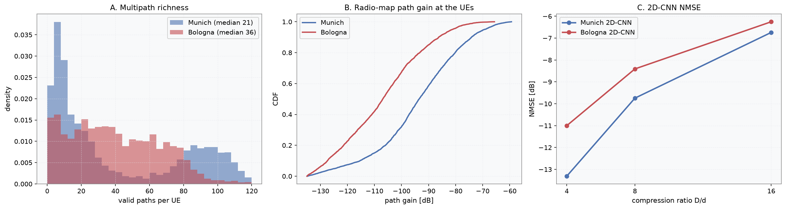

## Limitations and interpretation

1. **Approximate Bologna scene:** building footprints come from OpenStreetMap, and missing heights are estimated using rules and defaults. The scene does not reproduce every material, interior, vegetation feature, or street-level object. Munich uses a built-in Sionna scene with different provenance and control.
2. **Uncontrolled city comparison:** each city has different geometry, radio placement, and sampling area. These results describe the simulated configurations and cannot isolate a causal effect of urban morphology.
3. **Simulated narrowband channels:** results are for 3.5 GHz and one 8 × 8 matrix per realization. They do not validate measured channels, wideband OFDM, mobility, or CSI estimation errors.
4. **No quantization or feedback channel:** latent values are transmitted as noiseless floating-point numbers. The `128 / d` ratio excludes bit coding, quantization, protocol overhead, and transmission errors.
5. **Limited generalization evidence:** a random split distributes positions from the same scene across train and test. It is not a test on a completely unseen district or a different city.
6. **Run-to-run variation:** the CSV files preserve archived experiments. Re-running them can produce small differences depending on software versions, accelerator, and deterministic-operation support.

## Repository structure and execution

- `../Project_22_MIMO_CSI_Compression.ipynb` contains the complete workflow: configuration, cached data loading, model training, KPI computation, visualizations, and the optional Bologna scene-generation appendix.
- `../data/munich_csi_5000.npz` and `../data/bologna_csi_5000.npz` are the cached CSI datasets.
- `../results/` contains the archived figures and metric tables. Regenerated live outputs are kept separately in `../results/live/` and are excluded from version control.
- `../scenes/` contains scene assets and the cached OpenStreetMap data used for Bologna.

From the repository root, install the locked dependencies and launch the notebook:

```bash
uv sync
uv run jupyter lab Project_22_MIMO_CSI_Compression.ipynb
```

The notebook defaults to loading archived datasets and results. Its configuration cells control optional ray tracing, training, and rendering; enabling those steps may require additional Sionna platform setup and substantially more compute time.
